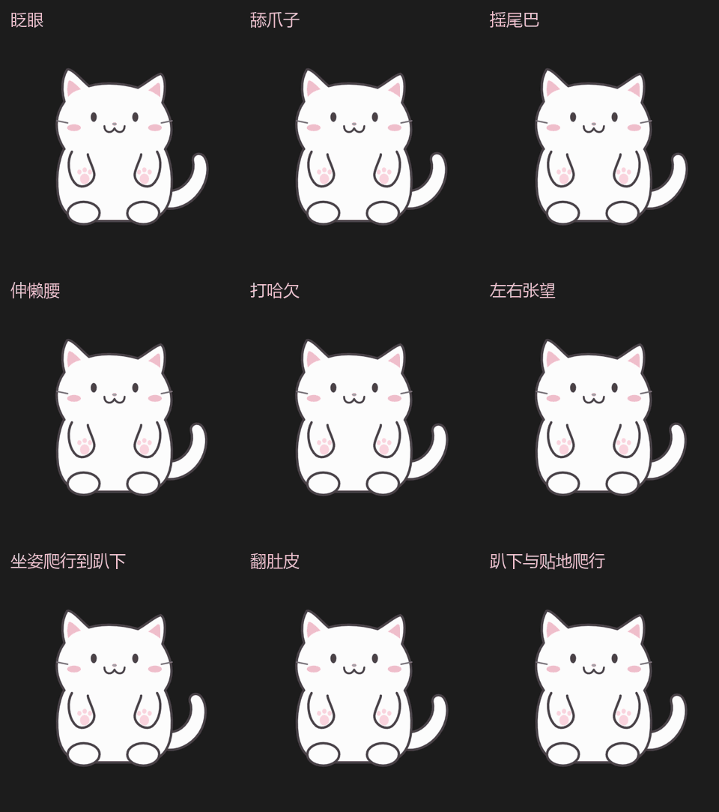

# BongoCat Android · 分层矢量与 Rive 动画

在原 BongoCat 形象上重做头、身体、四爪和尾巴。保留白色圆胖轮廓、小黑眼、W 嘴、粉色细节及原有功能。工程直接生成 Rive 原生模型，不需要拖拽导入或 Computer Use。

包名 `com.yuyu.bongocat`，版本 **3.13 / 16**，minSdk **26**，targetSdk **34**。继续使用原有签名、首选项和位置数据。应用只播放本地资源，没有增加 INTERNET 权限。

**[下载最新安装包](https://github.com/yangyuyu666/bongocat-android/releases/latest)** · [3.13 更新记录](FIXES.md) · [真机验收项目](DEVICE_TESTS.md)

## 动作预览



[点击互动](docs/previews/interactions.gif) · [休息与起身](docs/previews/rest.gif) · [横屏与举牌](docs/previews/edge-and-sign.gif)

预览由原生 Rive 模型渲染，包含与 3.13 相同的动画资源；横屏图展示模型姿势，不包含手机浮窗移动轨迹。举牌文字来自 Android 原生文字视图。

## 保留的功能

| 功能 | 行为 |
| --- | --- |
| 7 种随机动作 | 眨眼、舔爪、摇尾、伸懒腰、哈欠、张望、坐姿爬行；一轮内不重复，动作间保留随机休息。 |
| 9 个手动动作 | 保留动作页及以上七项、翻滚、趴地爬行的原有触发器。 |
| 睡眠 | 闲置 90 秒进入 6 秒瞌睡，再进入睡眠；互动重置计时，0.9 秒起身。 |
| 有限爬行 | 爬行 3.8 秒后趴着保持；点击/拖动唤醒，边界转向、限位和终点保存不变。 |
| 外观 | 8 种猫色 × 6 种配饰；换色覆盖头、身体、四爪及尾巴，配饰保持自己的颜色。 |
| 大小、透明度 | 120～300dp、10～100%；预览及浮窗各有独立的 Rive 实例。 |
| 浮窗 | 拖动、显示/收起、前台通知、权限检查、设置迁移与位置保存不变。 |

## v3.13：长按只打开工具弹窗（2026-11-18）

修复长按悬浮猫时把后台主界面一起拉到前台的问题。悬浮猫和到时通知使用独立的 `PetToolsPopupActivity`，与主界面的任务栈隔离；弹窗不进入最近任务，也不显示应用启动预览。菜单、番茄钟、便利贴和待办沿用原有表单，从猫咪打开时都按宠物位置摆放。首页工具箱入口保持原来的行为，动画和工具数据不变。

任务隔离采用 [Android 独立 Activity 的官方配置](https://developer.android.com/develop/ui/views/notifications/navigation#ExtendedNotification)。新增 Android 9 / 14 下的启动入口、任务配置、表单定位、关闭和草稿恢复回归；真实系统任务切换仍需手机验收。

## v3.12：连贯的趴姿轮廓（2026-11-18）

趴下、趴地爬行、睡眠和起身改用连贯的外轮廓：生成时将头、躯干、四肢和尾根的贝塞尔填色区域合并，再统一描边，去掉头部下沿、躯干和爪根之间的重复边线。头部下压，身体变低，前爪向前伸展；保留少量爪子和后腿的内侧线，起身时逐渐恢复坐姿的四爪线条。眼睛、嘴和配饰继续跟随头部。

`tools/rive/silhouette.mjs` 使用固定版本 Paper.js 0.12.18 做生成阶段的矢量几何合并，运行时不新增绘图库。模型包含 109 张共享姿势、43 条时间轴；翻身和横屏藏身保留原来的分层控制。番茄钟、便利贴、待办、长按和原有外观功能保持不变。

新增几何回归覆盖 290 个采样帧，验证每个趴姿只有一个闭合外轮廓、不越出画板；另保留原有的 76 张藏身连续性截图回归。原生预览检查了趴下、爬行、睡眠、起身和深色围巾组合。真机体验仍待验证。

## v3.11：长按工具箱、番茄钟和举牌便利贴（2026-11-18）

长按悬浮猫打开旁边的菜单，移动超过拖动阈值后取消长按。菜单优先放在右侧，空间不足时换边，过长表单可以滚动。首页也有工具箱入口。

- 番茄钟：自定义 1～360 分钟，提供 15/25/45/60 分钟快捷项，支持暂停、继续和结束。到时猫咪举牌，同时通过独立通知渠道提醒；可以确认或开始 5 分钟休息。
- 便利贴：保存最多 1000 字，牌子显示两行摘要，点击牌子放大完整内容；收起牌子会保留文字。编辑草稿在旋转后保留。
- 待办清单：最多 20 项，每项最多 120 字；支持勾选、取消勾选和清理已完成，修改后自动保存。

新增 `RaiseSign` / `HoldSign`，总共 43 条时间轴。牌子在 Rive 内绘制，原来的肩、肘、腕骨骼抬爪握住上沿，Android 文字按同一套 500×500 坐标绘制。举牌期间维持坐姿、呼吸和眨眼；横屏暂时完整显示，收牌后恢复探头。到时牌子优先于便利贴，确认后恢复原便签。

`PetToolsStore` 保存独立工具数据；同次开机用单调时钟计时，重启后按保存的日期恢复。`PetReminder` 使用 AlarmManager，服务轮询和系统闹钟通过同一个完成状态去重。隐藏宠物不取消闹钟；重启或覆盖升级后重新安排。系统强行停止应用会停止其闹钟，重新打开工具箱后恢复。

首次使用番茄钟会请求 Android 13+ 的通知权限；页面提供通知设置和 Android 12+ 的准时提醒授权入口。未授权通知时仅举牌，未授权精确闹钟时采用普通闹钟，锁屏省电下可能延迟。声音和振动遵循手机的通知渠道与勿扰设置。

按用户偏好移除菜单说明、表单说明和牌子上的“点击放大”小字，保留功能按钮、输入标签和必要的权限状态。

新增 Android 9 / Android 14 的 Robolectric 测试，覆盖计时持久化、暂停、旧闹钟失效、提醒去重、通知拒绝、精确闹钟降级、重启恢复、便签与待办、表单输入和旋转。用原生 Android 控件渲染表单截图，并用 Rive 原生渲染器检查举牌动作。真机浮窗、软键盘和后台提醒仍需设备验证，清单见 `DEVICE_TESTS.md`。

模型回归共用一个 CLI 命令进程，每个场景重新创建 `BongoCat` 画板，减少本机 CLI 重复启动失败。单独检查换画板后毛色、闲置计时、随机动作记录和举牌标记全部复位；保留原有动作时长与状态断言。

## v3.10：修复藏身时头身断开（2026-11-18）

横屏藏身时，身体下沉距离从 350 调整为 200 个画板单位，并与头部使用相同的逐帧时序，保持下巴与胸口重叠。尾巴在下沉前收低，避免尾根出画后剩下独立尾尖。最终仍只露出脑袋，原有交互、外观和横竖屏位置恢复保持不变。姿势库现为 102 张，时间轴仍为 41 条。

新增 `verification/model-tests` 中的 `RiveContinuityTest`，直接读取 76 张原生截图，逐帧检查普通毛色、深色围巾、途中返回竖屏和重新跑动。旧版在 `white-7.png` 检出头身断开，修复后通过。验证记录见 `verification/head-connection-v3.10`。

```powershell
.\gradlew.bat -p verification/model-tests test --tests '*RiveContinuityTest'
```

## v3.9：部位点击与横屏探头（2026-11-18）

待机时点尾巴摇尾、摸头眯眼低头、碰鼻子缩头再歪头、点前爪抬对应爪、点身体伸懒腰。连续点头三下会转头躲闪再看回来；仰躺露肚皮阶段可以点腹部，让后脚轻蹬两下。点击区域按 Rive 的实际缩放换算，拖动和取消手势不触发部位动作；趴下和睡眠仍可点击唤醒。

横屏时，悬浮猫跑到最近的底角，再把身体藏到屏幕下方，只露出脑袋。探头期间可以摸头，随机动作和睡眠不会把身体带出来。窗口同步缩小到头部附近；竖屏恢复之前的位置。横屏下从动作页点名播放动作，会先完整露出，播放后再回到边缘。外观更新、反复旋转、拖动和服务退出不把临时探头位置写进竖屏坐标。

`PetInteraction` 负责部位判断，`EdgePeekMotion` 负责位置与窗口范围，`RiveView` 和 `FloatingPetService` 接收触摸及旋转事件。新增 `tools/rive/interactions.mjs` 扩展原状态图；当前共有 41 条时间轴、99 张共享矢量姿势。验证记录在 `verification/interactions-v3.9`，真机检查项见 `DEVICE_TESTS.md`。

## v3.8：逐帧重画翻身与趴爬（2026-11-18）

翻肚皮重新绘制坐姿、侧倾、侧躺、仰躺和起身的轮廓。头随身体翻向地面，圆弧背部贴地，四爪向上蜷起并轻轻蹬动；腹部改为小块浅色区域。动作仍为 4.5 秒，保留原触发器。

趴爬重画为短圆爪、弯肘和爪背趾线，支撑阶段脚掌落地，回收阶段抬起；胸口、前臂和脚掌保持连接。趴下、睡眠、起身使用相同的姿势库，准备及爬行时长不变。逐帧部件均绑定原有毛色，面部和配饰继续跟随同一个头部。

`tools/rive/frame-poses.mjs` 从关键姿势生成 89 张矢量画面，Rive 的 Solo 按 15 帧/秒切换画面，并在动作之间复用静止姿势。四肢轮廓的顶点按肩、爪底、肩的顺序对应，避免中间帧自交收缩。眨眼、舔爪、哈欠等原有骨骼和面部动画继续使用连续关键帧。应用不加载 GIF 或图片序列。

原生渲染预览和自动检查不能代替审美判断或真机体验；交付验证记录见 `verification/frames-v3.8`。本机未连接 Android 真机。

## 前肢连接修正（2026-11-18）

前肢从独立平移的爪子改为肩、肘、腕三段骨骼驱动的连续轮廓，肩部随躯干保持连接。舔爪按肩部圆弧抬起、转腕，头部随后低下，分三次舔舐后沿弧线放回；爪子绘制节点本身不再平移。v3.7 为趴爬、翻肚皮另补了对应视角的前肢轮廓，原有状态图、时长及用户功能不变。

`tools/rive/forelimbs.mjs` 负责前肢轮廓、蒙皮权重及关节求解。模型目前共有 3 条骨骼链：尾巴、左前肢、右前肢，各 3 段。回归测试检查舔爪时肩部固定、绘制节点不平移且肩肘腕都参与转动。

## 本次重构

- 尾巴改成自然上翘轮廓，用三段骨骼及顶点/控制柄混合权重弯曲，去掉原来的螺旋形尖角。
- 头、躯干、四爪、面部和配饰分别成层；仰躺和趴爬使用逐帧躯干与四肢，复用头部表情、配饰及外观绑定。
- 眨眼、舔爪、呼吸、打哈欠和张望使用分部位动作；爬行交替迈爪，结束后平滑落到趴姿。
- 保留原有 33 条时间轴、3 层状态机和全部数据字段，新增 8 条点击与横屏时间轴。
- 趴爬准备状态 16 提前展开浮窗；准备期 crawlProgress 为负值，实际爬行从非负进度开始，不再依赖异步事件残留标记。
- 新动作、点击、拖动或释放视图时取消待执行的旧动作；两种爬行都在尺寸变化时停止旧路线。

## 编辑和生成

```powershell
pnpm --dir tools install --frozen-lockfile --ignore-scripts
node --test tools/rive/silhouette.test.mjs
node tools/generate-rive.mjs
& "$env:USERPROFILE\.rive\bin\rive.exe" rive --verify --format=json
& "$env:USERPROFILE\.rive\bin\rive.exe" inspect rive --summary
node tools/preview-rive.mjs
powershell -NoProfile -ExecutionPolicy Bypass -File tools/export-rive.ps1
```

- `tools/rive/bongocat-art.mjs`：分层路径、配饰和尾骨绑定。
- `tools/rive/frame-poses.mjs`：翻身、趴爬及睡醒过渡的逐帧矢量姿势库。
- `tools/rive/silhouette.mjs`：生成趴姿的连贯贝塞尔外轮廓，移除部件相交处的重复边线。
- `tools/rive/bongocat-motion.mjs`：动作姿势、分部位运动和关键帧压缩。
- `tools/rive/behavior.json`：原有状态图、属性 ID、动作时长与行为控制轨道。
- `tools/rive/vector.mjs`：同一份路径生成 SVG 和原生 RML。
- `rive/bongocat-layered.svg`：静态分层矢量源，包含可单独编辑的 path 和分组。
- `rive/scene.rml`：生成后的完整可编辑模型；重新生成会覆盖它，应优先修改上面的源模块。
- `build/visual-review`：原生 Rive 渲染的动作帧、换装帧和截图日志；不是 Android 设备截图。

正式导出使用当前登录的 Rive CLI，生成 `.riv` 和可继续编辑的 `.rev`，将运行时文件复制到 `app/src/main/res/raw/bongocat.riv`。`rive/export.sha256` 记录源码、配置及打包资源哈希；Gradle 会拒绝过期导出。

当前 Rive 账号方案会给正式导出的运行时附带 Rive splash 标识。CLI 本地预览帧没有该发布标识，不能据此判断 APK 没有标识。导出后的 `rive/build/bongocat.riv` 可能被后续本地预览覆盖，**打包和交付应读取 res/raw 中经过正式导出并记录哈希的资源**。

## 本机验收结果（2026-11-17）

正式 .riv/.rev 与 Release APK 已生成；18 项测试全部通过，0 跳过。`assembleRelease assembleDebugAndroidTest lintDebug testDebugUnitTest` 完整通过，Lint 0 错误 / 41 警告。336 张动作/换装帧与 48 组外观检查通过，APK 签名与原版一致。

历史记录中提到的 `verification/` 日志为本机输出，不随公开源码发布；仓库只保留 `verification/model-tests/` 的测试源码。

本机未连接 Android 设备，因此设备仪器测试与真实浮窗体验尚未验证。构建时通过临时下载中继解决本机 TLS 依赖下载问题，工程仓库配置未改。详细结果、构建日志、签名及帧边界记录在 `verification/refinement`。

## 构建与验证

Gradle 8.13 / AGP 8.13.2，Rive Android 11.16.3，compileSdk 36 / Build Tools 36.0.0；JDK 17 以上，本机使用 `D:\tools\jdk21`。

首次克隆后，配置 `JAVA_HOME` 和 Android SDK，并在未提交的 `local.properties` 中填写 `sdk.dir`，也可以设置 `ANDROID_HOME`。仓库包含已正式导出的 Rive 资源，直接构建 APK 不需要先登录 Rive；修改动画后才需要重新生成和导出。

发布签名密钥不会上传到 GitHub。自行编译前，在仓库根目录创建自己的本地测试密钥；仅在 `debug.keystore` 不存在时执行：

```powershell
if (-not (Test-Path -LiteralPath debug.keystore)) {
    & "$env:JAVA_HOME/bin/keytool" -genkeypair -keystore debug.keystore -storepass android -keypass android -alias androiddebugkey -keyalg RSA -keysize 2048 -validity 10000 -dname "CN=Android Debug,O=Android,C=US"
}
```

自行生成的密钥与 Releases 安装包签名不同，不能直接覆盖安装官方发布包；维护现有版本时继续使用本机原密钥。

```powershell
$env:JAVA_HOME = 'D:\tools\jdk21'
$env:GRADLE_USER_HOME = Join-Path (Get-Location) '.gradle-user-home'
$env:ANDROID_USER_HOME = Join-Path (Get-Location) '.tools\android-user'
./gradlew.bat testDebugUnitTest assembleRelease assembleDebugAndroidTest lintDebug
```

模型测试直接调用 Rive 引擎，覆盖 9 个手动动作、7 个随机动作、睡眠、唤醒、趴爬准备/结束和轮换；移动测试覆盖准备期、边界、取消及终点保存。Robolectric 检查设置迁移、外观组合和数值范围。

没有 Android 设备连接时只能编译仪器测试，不能声称已验证真实浮窗、触摸、GPU 透明度和覆盖安装。设备验收项目见 `DEVICE_TESTS.md`。

Release APK 在 `app/build/outputs/apk/release/app-release.apk`。debug/release 都使用根目录既有 `debug.keystore`，证书 SHA-256：

```text
f89eb1342441f6dd6a62de79f1a54cc527ce3838c9f26c45f28084d8dc501eb4
```

安装包通过 [GitHub Releases](https://github.com/yangyuyu666/bongocat-android/releases) 分发。`dist/`、构建缓存、签名密钥和本机验证日志不提交到仓库；历史改动记录见 `FIXES.md`。

3.13 的本机结果：22 项工具相关回归通过（含 Android 9 / 14 的独立弹窗检查），`assembleRelease` 和 `lintDebug` 成功；Lint 0 错误 / 51 警告。尚未连接真机验证系统任务切换。
